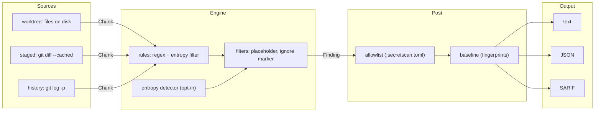
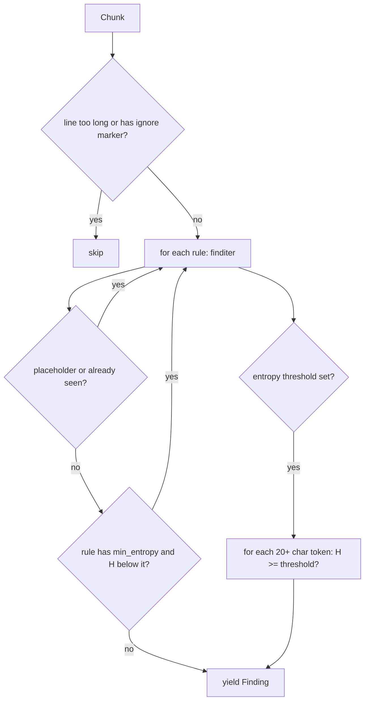
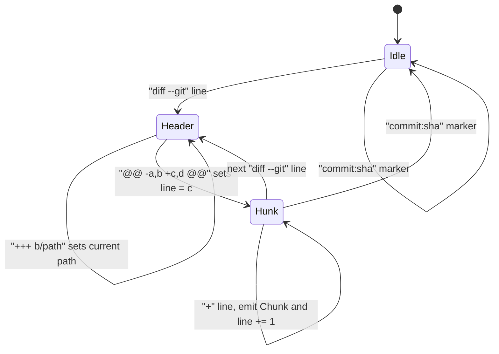

<h3 align="center">secretscan</h3>

---

Find leaked secrets in files, staged changes and git history

## Architecture

The core design rule: Three independent stages that only communicate through small data types.

## Engine

Turn chunks of text into findings.

## Sources

sources turn the outside world into `Chunk`s. Three of them share one diff parser.

